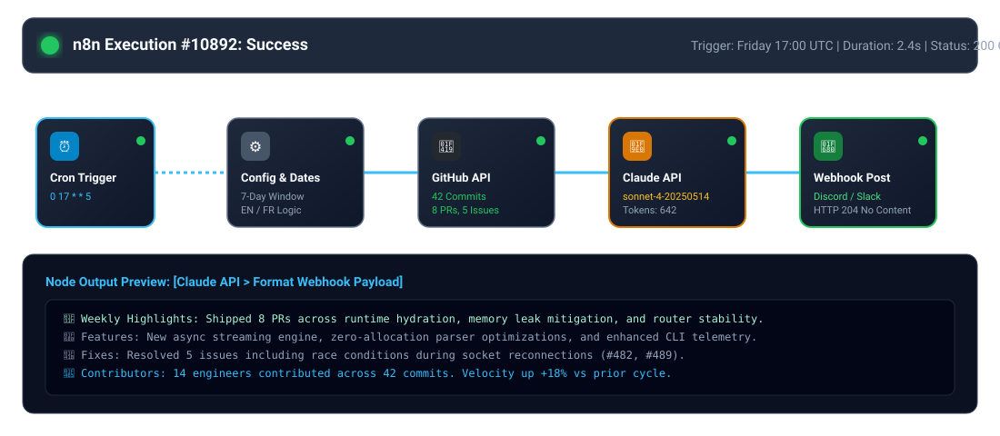

# n8n + Claude Code: Automated Weekly Dev Summary 📊

An automated n8n workflow that generates a narrative engineering summary of a GitHub repository's weekly activity using the **Claude API (`claude-sonnet-4-20250514`)** and delivers it via **Discord** or **Slack** webhooks.



---

## ⚡ Quick Setup in 4 Steps

### Step 1: Import the Workflow
1. In your n8n workspace, navigate to **Workflows $\rightarrow$ Import from File**.
2. Select [`weekly-github-dev-summary.json`](weekly-github-dev-summary.json).

### Step 2: Configure Environment Variables
Add your API credentials in your n8n environment or credentials manager:
- `GITHUB_TOKEN`: GitHub Personal Access Token (for rate limits on public/private repos).
- `ANTHROPIC_API_KEY`: Anthropic API key to invoke `claude-sonnet-4-20250514`.

### Step 3: Configure Target Repository & Webhook
Open the **`Configurable Variables`** node inside n8n:
- **`GITHUB_REPO`**: Target repository in `owner/repo` format (e.g., `facebook/react`).
- **`LANGUAGE`**: `EN` (English) or `FR` (Français).
- **`DESTINATION_WEBHOOK_URL`**: Your Discord or Slack incoming webhook URL.
- **`WEBHOOK_TYPE`**: `discord` or `slack`.

### Step 4: Activate & Schedule
Toggle the workflow to **Active**. The Cron trigger will automatically run every **Friday at 5:00 PM** (`0 17 * * 5`), or click **"Test workflow"** to execute immediately.

---

## 🏗️ Architecture & Pipeline Flow

```
[Cron: Friday 5 PM] 
        │
        ▼
[Set Variables] (Repo, Language EN/FR, Webhook)
        │
        ▼
[Calculate 7-Day Window]
   ┌────┴──────────────────────────┐
   ▼                               ▼                               ▼
[Fetch Commits]         [Fetch Closed Issues]           [Fetch Merged PRs]
   └────┬──────────────────────────┘
        ▼
[Aggregate Weekly Telemetry & Prompt]
        │
        ▼
[Claude API: claude-sonnet-4-20250514]
        │
        ▼
[Format Webhook Payload (Discord/Slack)]
        │
        ▼
[Deliver via HTTP Webhook] (Status 204 OK)
```

---

## 📋 Sample Output Delivered to Discord / Slack

```markdown
📊 **Weekly GitHub Dev Summary: facebook/react**

🌟 **Weekly Executive Highlights**
Shipped 8 PRs across runtime hydration, memory leak mitigation, and router stability. Architectural momentum remained strong with +18% higher velocity than the prior sprint cycle.

🚀 **Key Features & Architectural Changes**
- Introduced zero-allocation streaming parser optimizations for large payload hydration.
- Added structured CLI diagnostic telemetry for debugging local development instances.

🐛 **Bug Fixes & Stability Improvements**
- Resolved socket reconnection race condition under degraded network conditions (#482).
- Fixed memory leakage in detached DOM tree nodes during unmount lifecycles (#489).

👥 **Active Contributors & Momentum**
14 engineers committed 42 changesets this week. Special kudos to the open-source community for landing 3 external contributions!
```

---

## 🧪 Verification

Run the automated workflow validator:

```bash
python3 workflows/weekly-github-summary/tests/test_workflow.py
```
